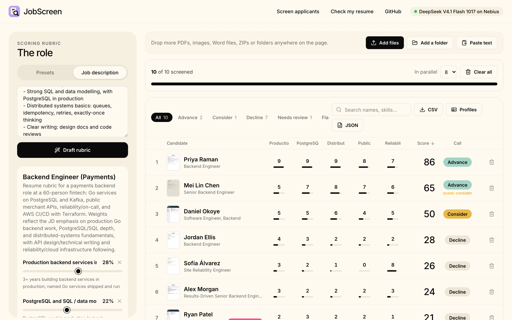
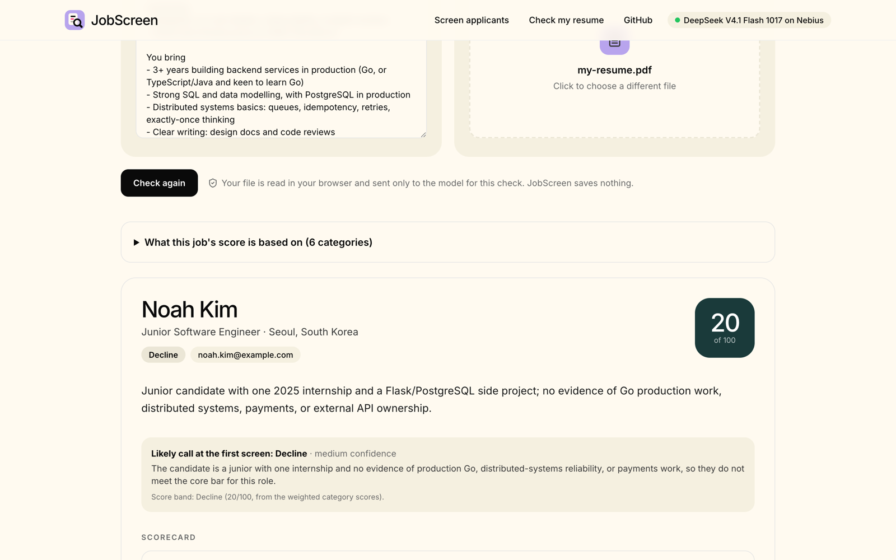

<div align="center">


# JobScreen

### A resume score that shows its work.

**Score any resume against any job, with the evidence behind every point.** Recruiters rank applicants from their ATS export and read the strongest first. Job seekers see their score before they apply, and what would get them filtered out. Open source, powered by [DeepSeek V4.1 Flash 1017](https://tokenfactory.nebius.com/?modals=endpoint-details&model-id=deepseek-ai/DeepSeek-V4.1-Flash-1017) vision.


[](https://tokenfactory.nebius.com/?modals=endpoint-details&model-id=deepseek-ai/DeepSeek-V4.1-Flash-1017)
[](https://dub.sh/aistudio)
[](https://mastra.ai)
[](./LICENSE)
[](https://studio1hq.com)

<a href="public/demo/jobscreen-demo.mp4"></a>

_Screening ten made-up applicants for a backend engineering job, then checking one resume as a job seeker. [Watch the video](public/demo/jobscreen-demo.mp4)._

</div>

## What it does

Most screening tools turn a PDF into text and hand it to a model. Scanned resumes come back empty, and text hidden in the file (white or microscopic) reaches the model even though no person can see it. JobScreen reads the rendered page instead.

### For recruiters: rank applicants, read the best first

- Drop **up to 50 resumes at a time**: PDFs, scans, Word files, a ZIP export from your ATS, a folder, or pasted text. Add more batches whenever you like.
- Paste a **job description** and get a weighted rubric you can edit, or start from a preset.
- Get a **ranked shortlist**. Each candidate has a score per category with quotes from their resume, the model's call (advance / consider / decline) with its reason, red flags and tailored interview questions.
- **Links are opened to check they load.** Project repos that are private, missing or on a different GitHub account than the candidate's are flagged; a GitHub name that differs from the resume isn't.
- **Hidden-text tricks are caught** and shown word for word.
- Sort, filter and search, step through scorecards with **← →**, and export **CSV**, structured **profiles** ([JSON Resume](https://jsonresume.org/schema)) or full **JSON**.

<div align="center"></div>

### For job seekers: your score before you apply

Paste the job, add your resume, and see what would filter you out:
- the **likely call** and why;
- your **score** per category, with the lines that earned it;
- the **gaps** that cost you, and what would hold you back;
- the **questions** you'd likely be asked;
- **broken links**, and **hidden text** in your PDF.

Nothing is stored.

<div align="center"></div>

## What powers it

- **[DeepSeek V4.1 Flash 1017](https://huggingface.co/deepseek-ai/DeepSeek-V4.1-Flash-1017)** reads each resume as page images, so scans, photos and designed layouts count. Its 1M-token context fits any resume, and its weights are open (MIT).
- **[Nebius Token Factory](https://dub.sh/aistudio)** runs it behind an OpenAI-compatible API. Turn on Zero Data Retention and applicant data isn't kept.
- **[Mastra](https://mastra.ai)** runs the screening as one workflow: read, check links and GitHub, then score and build the profile in parallel.

## Get started

Use **Node.js 22+** and **pnpm**:

```sh
git clone https://github.com/Studio1-OSS/JobScreen.git
cd JobScreen
pnpm install
cp .env.example .env      # add NEBIUS_API_KEY
pnpm dev
```

Open **http://localhost:3300**:
- recruiters: **Screen applicants**, then **try 3 sample resumes**;
- job seekers: **Check my resume**, then **Use an example** job.

| Variable | What it does |
| --- | --- |
| `NEBIUS_API_KEY` | **Required.** Model calls via [Nebius Token Factory](https://tokenfactory.nebius.com). |
| `JOBSCREEN_ACCESS_KEY` | **Set it on any public deployment**, so only people with the key can use your credits. |
| `GITHUB_TOKEN` | Optional. Raises GitHub's limit from 60 to 5,000 lookups an hour, for big batches. |
| `NEBIUS_MODEL` | Optional. Another vision model with structured output and reasoning control; check it with `pnpm smoke:nebius`. |

The rest are in [`.env.example`](.env.example). To deploy, use any Node host (Vercel works) that allows functions to run for up to 180 seconds; most resumes finish in 10-25. Details, architecture and how to extend it: [docs/how-it-works.md](docs/how-it-works.md).

## How well it works

Tested on 50 real, anonymised resumes ([method and numbers](bench/README.md)):
- **Scanned resumes read as well as the originals**, where text extraction gets nothing from them.
- **Hidden-text tricks are caught:** in 50 of 50 resumes that had them, with no false alarms on 50 clean ones.
- **The right people rank high:** the right resume came out #1 for 7 of 10 roles, even when 30% of the pile arrived as scans.
- **Scores are steady:** the same resume scored twice lands about 3 points apart.

## Responsible use and privacy

- **JobScreen supports a human reviewer; it doesn't replace one.** It never rejects anyone, and every score shows its evidence.
- **Screening laws apply.** Automated screening is regulated in places such as New York City (Local Law 144) and the EU (AI Act, high-risk). Check what applies to you, and keep a person in the loop.
- **The prompts ignore** name, age, gender, nationality, photos, school prestige and employment gaps.
- **JobScreen's server stores nothing.** Results stay in your browser until you press **Clear all**. Links on a resume are opened only to check that they load.
- **Keep applicant data private:** turn on Zero Data Retention in your Nebius organisation, so prompts and outputs aren't kept. Nebius doesn't train on your data.

## Credits

Inspired by HackerRank's open-source hiring-agent. Built with [Mastra](https://mastra.ai), [Octokit](https://github.com/octokit/octokit.js), [pdf.js](https://mozilla.github.io/pdf.js/), [tldts](https://github.com/remusao/tldts) and [ipaddr.js](https://github.com/whitequark/ipaddr.js). Benchmark data: the [Resume Dataset](https://www.kaggle.com/datasets/snehaanbhawal/resume-dataset) (CC0).

MIT licensed · [Contributing](./CONTRIBUTING.md) · [Security](./SECURITY.md)
